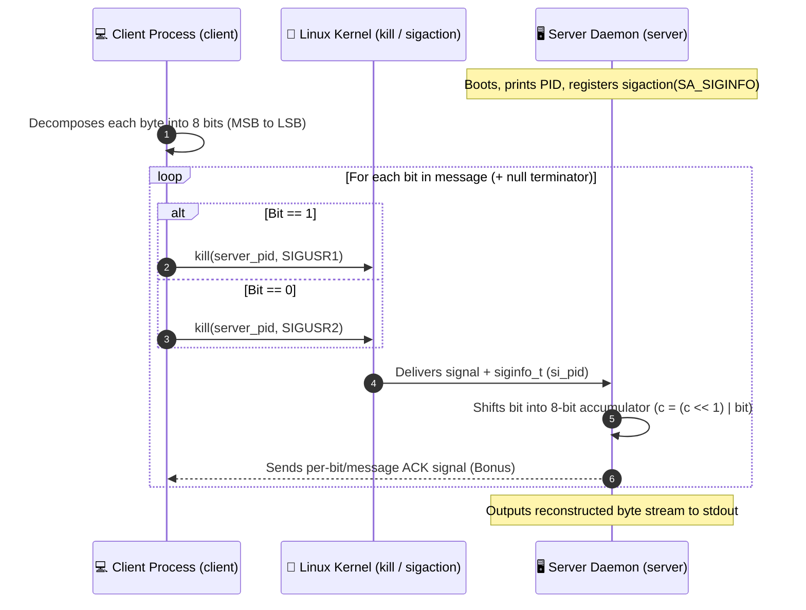

# minitalk — Bit-Level Unix Signal IPC Client & Server in C

<div align="center">

[-00599C?style=for-the-badge&logo=c&logoColor=white)](https://en.wikipedia.org/wiki/C_(programming_language))
[](https://1337.ma)
[%20%7C%20SIGUSR1%20%2F%20SIGUSR2-f59e0b?style=for-the-badge)](#)

</div>

---

## 📌 Overview

**`minitalk`** is a Unix Inter-Process Communication (IPC) project from the **1337 / 42 Network** curriculum consisting of a `server` daemon and a `client` transmitter that exchange arbitrary UTF-8/ASCII strings across processes using **only Unix user signals (`SIGUSR1` and `SIGUSR2`)**.

---

## 🏗️ Bitwise Signal Protocol



### Key Technical Concepts
- **Bitwise Serialization**: Each character is decomposed via bit shifts (`(byte >> bit_idx) & 1`) and transmitted as 8 consecutive signals (`SIGUSR1` for `1`, `SIGUSR2` for `0`).
- **Async-Signal-Safe Handling (`sigaction`)**: Uses `struct sigaction` with `SA_SIGINFO` to inspect `info->si_pid`, identify the sending client, reset state cleanly if a client PID changes mid-transmission, and acknowledge receipt.
- **Unicode & Multi-Byte Support**: Because transmission operates transparently at the raw byte/bit level, multi-byte UTF-8 sequences (Arabic, emojis, symbols) reconstruct identically on the server.

---

## 🛠️ Build & Run

```bash
# Build mandatory & bonus client/server binaries
make
make bonus

# 1. Start the server in Terminal 1 (prints its PID)
./server
# -> Server PID: 42137

# 2. Send a message from Terminal 2 using the server's PID
./client 42137 "Hello from 1337 / 42 Network! 🚀 مرحبا"
```

---

## 🔗 Companion 1337 / 42 Network Projects

| Repository | Focus Area |
|---|---|
| [**`libft`**](https://github.com/kmbenjel/libft) | 43 standard C library functions + singly linked list API reimplemented from scratch |
| [**`ft_printf`**](https://github.com/kmbenjel/ft_printf) | Variadic `printf(3)` reimplementation using `<stdarg.h>` |
| [**`get_next_line`**](https://github.com/kmbenjel/get_next_line) | Stateful buffered line reader across arbitrary Unix file descriptors (`read(2)`) |
